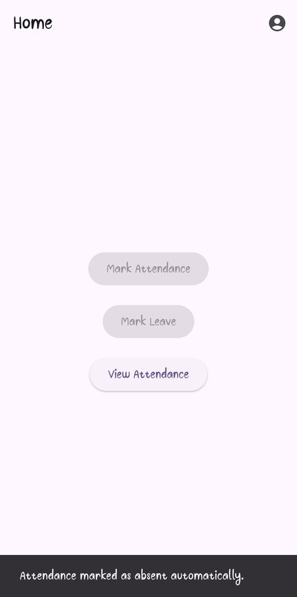
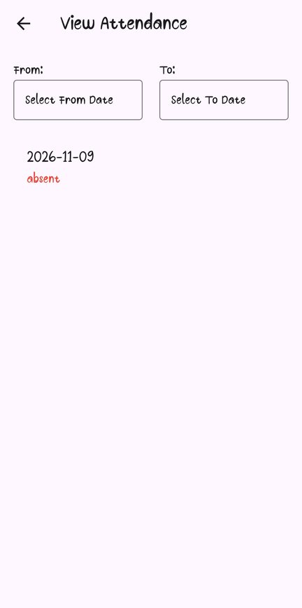
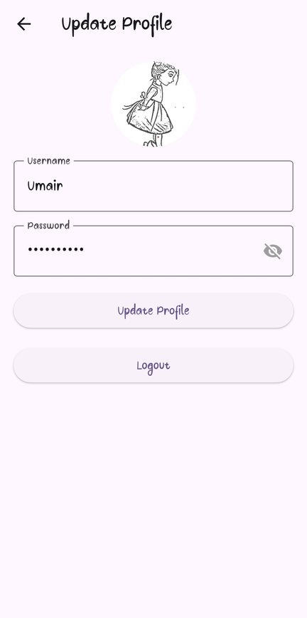
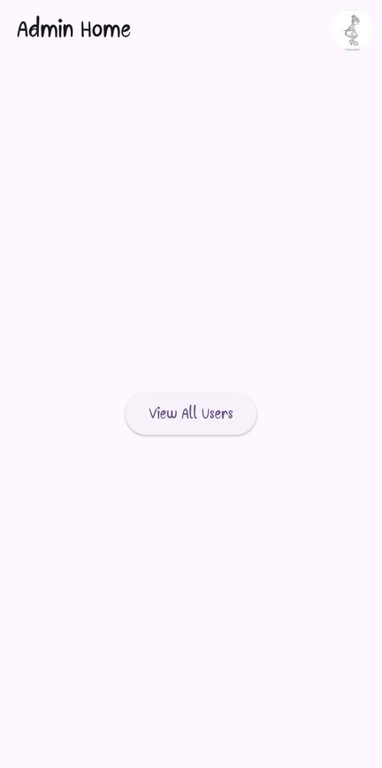
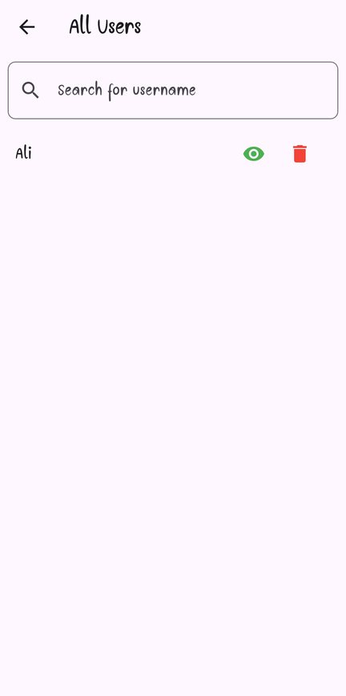
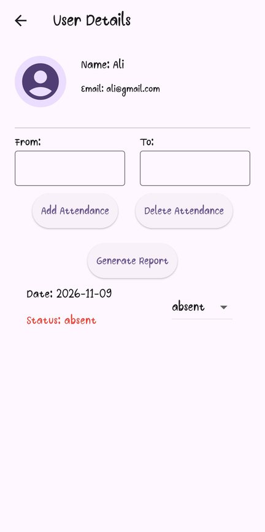

# Attendy (SQLite)

**An offline attendance app for Android, built with Flutter and SQLite: users check in or request leave, and an admin manages attendance and reports. Everything is stored on the phone, with no account or internet needed.**

[](https://github.com/Umair-Habibx123/attendy-sqlite/actions/workflows/ci.yml)
[](https://github.com/Umair-Habibx123/attendy-sqlite/releases/latest)
[](https://flutter.dev)
[](LICENSE)

**[⬇️ Download the latest APK](https://github.com/Umair-Habibx123/attendy-sqlite/releases/latest)** · Android 7.0+ · enable "Install unknown apps" for your browser or file manager first.

> **Two versions of Attendy.** This is the first one, a practice project that keeps all data in local SQLite databases on one phone.
> **[Attendy](https://github.com/Umair-Habibx123/attendy)** is the rebuilt version on Firebase: real accounts, an admin panel shared by the whole team, admin-approved leave, server-time check-ins and CSV/PDF reports.

| User home | Attendance history | Profile |
| :---: | :---: | :---: |
|  |  |  |
| **Admin home** | **All users** | **User attendance** |
|  |  |  |

## Features

**Everyone**
- Register and log in, choosing the **user** or **admin** role
- Update your profile: name, password and profile picture

**Users**
- **Mark attendance** once a day, between **8 AM and 1 PM**
- **Mark leave** for today, with a reason
- **Automatic absence:** opening the app after 1 PM without a record marks you absent
- **View attendance:** your history and totals

**Admins**
- **All users:** see everyone and open a user's details
- **Attendance by date range:** add or delete records for a user
- **Correct a day:** change any recorded day between present, absent and leave
- **Leave applications:** read a user's leave reason
- **Reports:** present, absent and leave totals for a date range
- **Delete users,** together with their attendance and leave records

## Install

1. Open the **[latest release](https://github.com/Umair-Habibx123/attendy-sqlite/releases/latest)** and download `Attendy-SQLite-vX.Y.Z.apk`.
2. Optionally check it against the `.sha256` file next to it.
3. Open the APK on your phone and allow installing from that app if Android asks.

To try both roles on one phone, register an admin and a user, then log out and in between them.

## Build it yourself

You need **Flutter 3.47+** and the Android SDK. No accounts or keys are needed.

```bash
git clone https://github.com/Umair-Habibx123/attendy-sqlite.git
cd attendy-sqlite
flutter pub get
flutter run                     # on a connected phone or emulator
flutter build apk --release     # APK in build/app/outputs/flutter-apk/
```

Without `android/key.properties`, release builds are signed with the debug key, which is fine for testing.

| Command | What it does |
|---|---|
| `flutter test` | Tests the SQLite helpers against a real SQLite database on your computer: log-in, unique emails, one check-in per day, and range totals |
| `flutter analyze` | Static analysis |

## How it's built

| Part | What it uses |
|---|---|
| Storage | `sqflite`: three local databases (`users.db`, `attendance.db`, `leave.db`) |
| Session | `shared_preferences` keeps you logged in |
| Media | `image_picker` for profile pictures, `screenshot` for reports |
| Dates | `intl` |

```
lib/
├── main.dart                    picks the user or admin app after login
├── shared/                      login, registration, the users database
├── user/                        check-in, leave, history, profile; attendance and leave databases
└── admin/                       users, per-user attendance, leave, reports, profile
```

## Known limitations

This version was built for practice, and it shows. All of these are fixed in [Attendy](https://github.com/Umair-Habibx123/attendy):

- **Plain-text passwords:** they're stored as typed in the local database.
- **Anyone can be admin:** the role is picked at registration.
- **Phone clock:** check-ins use the phone's time, so changing the clock changes the date.
- **One phone only:** data lives on one device, so an admin can only manage users registered on that phone.

## License

[MIT](LICENSE) © 2024 [Umair Habib](https://github.com/Umair-Habibx123)
